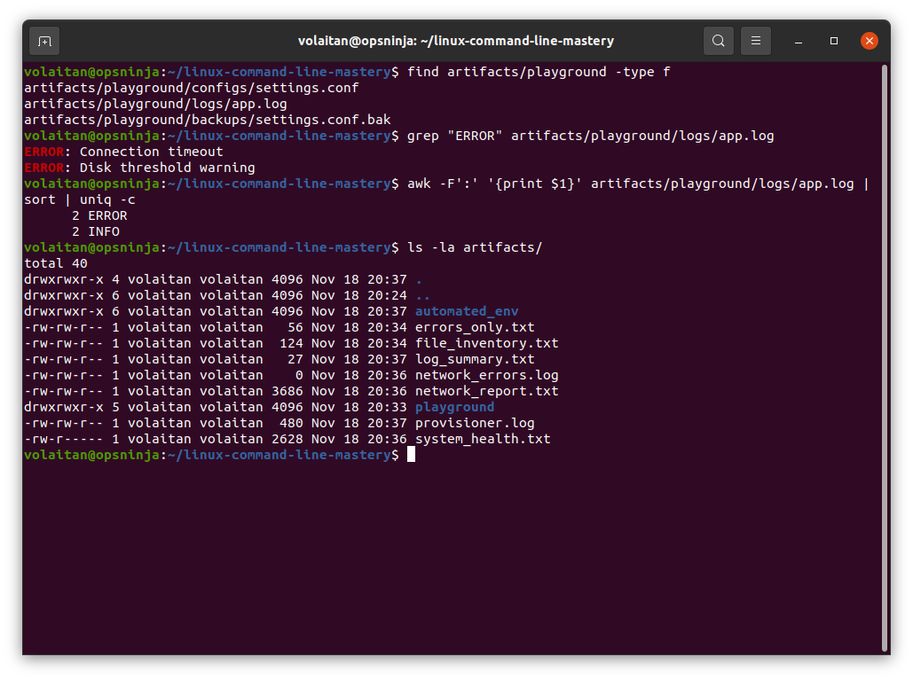
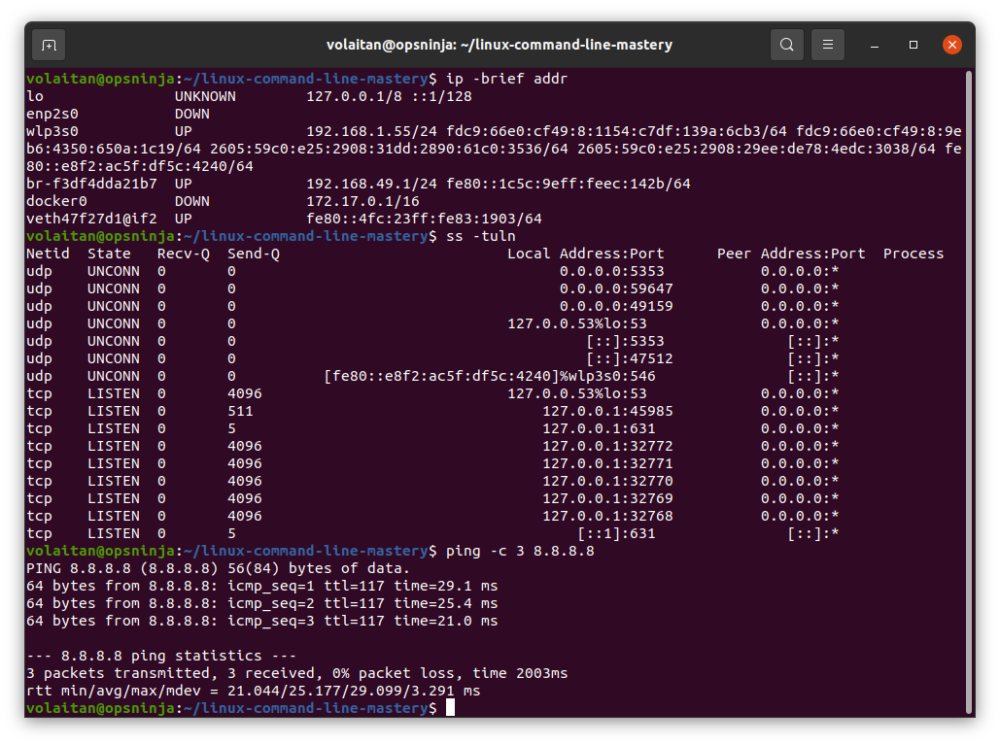

# Linux and Command Line Mastery

Comprehensive DevOps command-line engineering exercises, system resource diagnostics, and Bash automation built on **Ubuntu 24.04 LTS** (`opsninja`).

> **Detailed Technical Guide:** See [`docs/notes.md`](docs/notes.md) for complete conceptual breakdowns, command syntax explanations, permission models, and troubleshooting notes.

---

## Repository Structure
- `README.md` — Project overview, core concepts, command reference, completion checklist, and verification screenshots.
- `docs/notes.md` — Deep-dive explanations of file system navigation, `apt` package management, permissions (`chmod`/`chown`), redirection pipelines, and process telemetry.
- `scripts/workspace_provisioner.sh` — Executable, idempotent Bash script using variables, conditionals, loops, and audit logging.
- `screenshots/` — Visual terminal evidence verifying every task category.
- `artifacts/` — Generated system health reports, network diagnostics, log summaries, and provisioned directories.

---

## Core Concepts & Tasks Summary

### 1. File System Navigation & Package Management (`apt`)
* **Navigation:** Used `pwd` and `cd` (both absolute paths from `/` and relative paths via `..`) to traverse project directories and inspect `/etc` (system configs), `/var` (variable logs/caches), and `/tmp` (sticky-bit temporary storage).
* **Package Management:** Maintained system packages on Ubuntu 24.04 using `sudo apt update` (refreshing repository metadata) and `sudo apt install -y` to ensure standard GNU utilities (`coreutils`, `grep`, `gawk`, `procps`, `iproute2`) were installed and up to date.

### 2. File, Directory, & Permission Management
* **File Operations:** Created nested structures idempotently with `mkdir -p`, generated files via `touch`, duplicated configs with `cp`, safely tested deletions with `rm -i`, and queried files using `find` and `grep`.
* **Permissions & Ownership:** Enforced least-privilege access using numeric and symbolic `chmod` modes—restricting `artifacts/system_health.txt` to `640` (`-rw-r-----`), granting execute bits (`+x`) to `scripts/workspace_provisioner.sh`, and provisioning automated directories with `750` (`drwxr-x---`). Documented `chown` and `sudo` privilege boundaries in [`docs/notes.md`](docs/notes.md).

### 3. Redirection, Filtering & Shell Automation
* **Pipes & Redirection:** Separated clean output (`>`) from error streams (`2>`) during network diagnostics (`artifacts/network_report.txt` vs. `artifacts/network_errors.log`) and chained `awk | sort | uniq -c` to aggregate log severity counts (`2 ERROR`, `2 INFO`).
* **Bash Scripting:** Built [`scripts/workspace_provisioner.sh`](scripts/workspace_provisioner.sh) with `set -euo pipefail`, variables, `if/else` directory checks, `for` loops, and timestamped `tee -a` logging.

### 4. Process, Resource & Network Monitoring
* **System Telemetry:** Evaluated CPU load (`uptime`), physical/available RAM (`free -m`), root partition usage (`df -h /`), and top memory-consuming processes (`ps aux --sort=-%mem | head -n 6`).
* **Network Diagnostics:** Verified active interfaces (`ip -brief addr`), listening TCP/UDP sockets (`ss -tuln`), and external ICMP reachability (`ping -c 3 8.8.8.8` with `0%` packet loss).

---

## Completion Checklist
- [x] **File System Navigation:** `pwd`, `cd` (absolute & relative), `mkdir -p`, exploration of `/etc`, `/var`, `/tmp`
- [x] **Package Installation & Tools:** `apt update`, `apt install`, verification of core GNU & networking packages
- [x] **File & Directory Management:** `touch`, `cp`, `mv`, `rm -i`, `rm -r`, `cat`, `less`, `head`, `tail`, `find`, `grep`
- [x] **Permissions & Ownership:** `chmod` (`640`, `750`, `+x`), `chown`, `sudo` least-privilege configuration
- [x] **Pipes & Redirection:** `>`, `>>`, `2>`, `|`, `awk`, `sort`, `uniq -c`
- [x] **Process & System Monitoring:** `ps aux`, `top`, `df -h`, `free -m`, `uptime`
- [x] **Networking Basics:** `ip -brief addr`, `ss -tuln`, `ping`
- [x] **Shell Scripting:** Executable Bash automation script with variables, conditionals, loops, and logging

---

## Terminal Verification Evidence

### 1. File Operations, Permissions & Pipe Chains

### 2. Process & System Resource Monitoring

### 3. Network Interfaces & Listening Sockets

### 4. Executable Bash Provisioning Script

---

## Learning Summary
Mastering the Linux command line bridges manual system administration and automated DevOps pipelines. Combining single-purpose utilities through standard streams (`stdin`, `stdout`, `stderr`) and pipes (`|`) enables rapid log parsing and diagnostics without external dependencies, while encoding directory scaffolding and `chmod` rules into idempotent Bash scripts guarantees consistent, repeatable environments across cloud servers and CI/CD runners.
