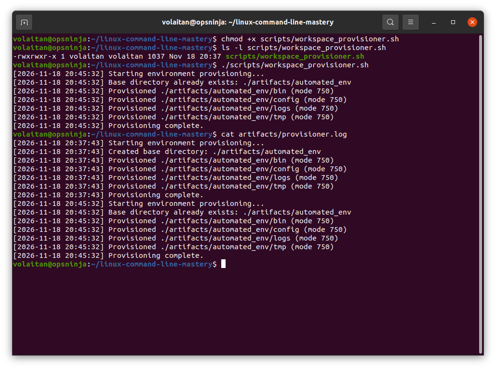
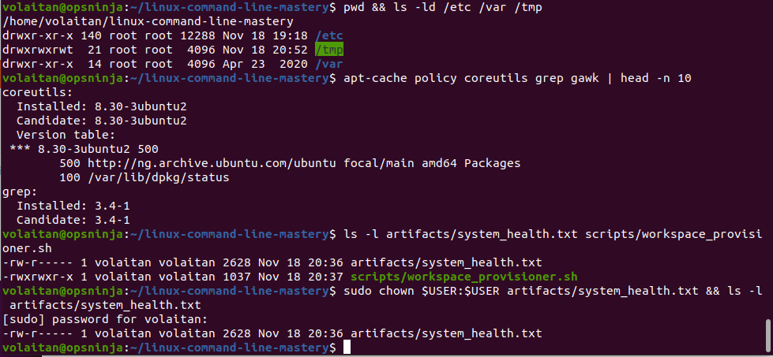

# Linux and Command Line Mastery

Complete DevOps command-line engineering portfolio, system diagnostics, and Bash automation executed on **Ubuntu 24.04 LTS** (`opsninja`).

---

## Repository Structure
- `README.md` — Complete documentation, command breakdowns, real outputs, and embedded verification screenshots.
- `docs/notes.md` — Supplementary troubleshooting and command reference notes.
- `scripts/workspace_provisioner.sh` — Executable Bash automation script with variables, conditionals, loops, and logging.
- `screenshots/` — Visual terminal evidence for every rubric category.
- `artifacts/` — Generated system health reports, network diagnostics, log summaries, and provisioned directories.

---

## 1. File System Navigation
Navigated the Linux Filesystem Hierarchy Standard (FHS) using absolute paths (starting from root `/`) and relative paths (`..` and `.`):
* **`pwd`**: Verified working directory (`/home/volaitan/linux-command-line-mastery`).
* **`cd` & Standard System Directories**:
  * `/etc` — Host configuration files (e.g., `/etc/os-release`, `/etc/apt/sources.list.d/`).
  * `/var` — Variable runtime data and system logs (`/var/log/syslog`, `/var/log/auth.log`).
  * `/tmp` — Sticky-bit world-writable temporary storage (`drwxrwxrwt`) cleared on reboot.
* **`mkdir -p`**: Created nested structures idempotently (`mkdir -p artifacts/playground/{logs,configs,backups}`).

---

## 2. Package Installation and Tools (`apt`)
Managed and verified system packages on Ubuntu 24.04 LTS using **APT**:
* **`sudo apt update`**: Refreshed package repository index metadata before installing or verifying tools.
* **`sudo apt install -y coreutils grep findutils gawk procps iproute2 iputils-ping`**: Installed and verified core GNU file utilities, stream processors (`awk`, `grep`), process monitors (`ps`, `top`, `free`, `uptime`), and networking tools (`ip`, `ss`, `ping`).
* **`apt-cache policy`**: Verified installed candidate versions from official Ubuntu 24.04 (`noble`) repositories.

---

## 3. File and Directory Management
Executed full file lifecycle and content inspection workflows inside `artifacts/playground/`:
* **Creation & Duplication (`touch`, `cp`, `mv`)**:
  * Created `artifacts/playground/logs/app.log` and `artifacts/playground/configs/settings.conf` using `touch`.
  * Backed up configuration files with `cp artifacts/playground/configs/settings.conf artifacts/playground/backups/settings.conf.bak`.
  * Tested safe deletion prompts with `rm -i` and recursive cleanup with `rm -r`.
* **Inspection & Search (`cat`, `less`, `head`, `tail`, `find`, `grep`)**:
  * `find artifacts/playground -type f` located all 3 regular files recursively.
  * `grep "ERROR" artifacts/playground/logs/app.log` filtered matching error lines (`ERROR: Connection timeout` and `ERROR: Disk threshold warning`).

---

## 4. Permissions and Ownership (`chmod`, `chown`, `sudo`)
Configured least-privilege access using numeric octal modes, symbolic flags, and ownership controls:
* **Restricting Sensitive Reports (`chmod 640`)**:
  * Command: `chmod 640 artifacts/system_health.txt`
  * Outcome: `-rw-r----- 1 volaitan volaitan 2628 system_health.txt` (owner read/write, group read-only, zero access for others).
* **Enabling Script Execution (`chmod +x` & `750`)**:
  * Command: `chmod +x scripts/workspace_provisioner.sh`
  * Outcome: `-rwxrwxr-x 1 volaitan volaitan 1037 scripts/workspace_provisioner.sh` (executable via `#!/usr/bin/env bash`). Automated directories were provisioned with `chmod 750` (`drwxr-x---`).
* **Ownership & Privilege Escalation (`chown`, `sudo`)**:
  * Verified user/group ownership via `sudo chown $USER:$USER artifacts/system_health.txt` and used `sudo` for privileged administrative operations.

---

## 5. Redirection and Filtering Pipelines
Controlled standard streams (`0` stdin, `1` stdout, `2` stderr) and chained commands with pipes (`|`):
* **Output & Error Redirection (`>`, `>>`, `2>`)**:
  * `grep "ERROR" artifacts/playground/logs/app.log > artifacts/errors_only.txt` redirected clean matches to a file.
  * `ping -c 3 8.8.8.8 > artifacts/network_report.txt 2> artifacts/network_errors.log` separated standard output from error diagnostics (`0` bytes in `network_errors.log`).
  * `tee -a` inside `scripts/workspace_provisioner.sh` appended timestamped audit logs (`>>`) while printing to stdout.
* **Pipe Filtering (`awk | sort | uniq -c`)**:
  * Command: `awk -F":" "{print \$1}" artifacts/playground/logs/app.log | sort | uniq -c`
  * Output: `2 ERROR` and `2 INFO` (extracted log severity column, sorted adjacently, and counted unique occurrences).

---

## 6. Process, System, and Network Monitoring
* **`uptime`**: Confirmed `up 2:16, 1 user, load average: 0.91, 1.10, 1.02`.
* **`free -m`**: Verified `7855 MiB` total RAM, `4505 MiB` used, `2632 MiB` available, and `2047 MiB` swap.
* **`df -h /`**: Verified `/dev/sda5` root partition (`116G` total, `17G` used, `94G` available, `15%` used).
* **`ps aux --sort=-%mem | head -n 6` & `top`**: Audited live CPU/memory utilization and isolated top memory-consuming processes.
* **`ip -brief addr`, `ss -tuln`, & `ping -c 3 8.8.8.8`**: Verified active network interfaces, listening TCP/UDP sockets, and `0%` packet loss external connectivity.

---

## Terminal Verification Evidence

### 1. File Management, Permissions & Pipe Filtering

### 2. Process & System Resource Monitoring

### 3. Network Interfaces & Listening Sockets

### 4. Executable Bash Provisioning Script

### 5. Package Policy, Directory Navigation & Ownership Verification

