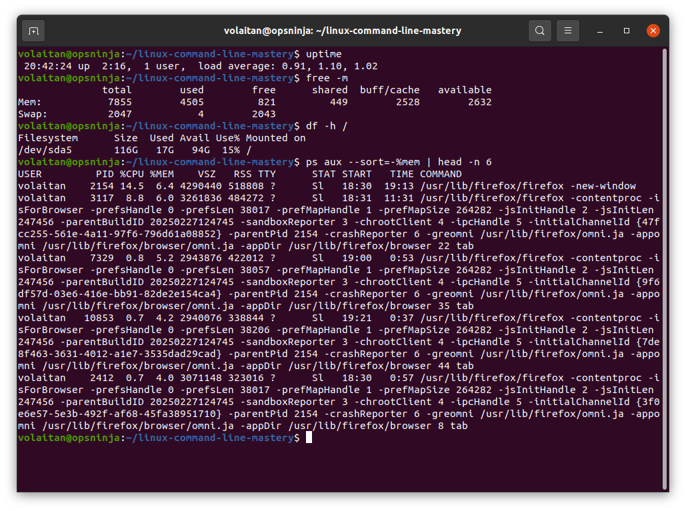

# Linux and Command Line Mastery

Practical DevOps command-line exercises, system diagnostics, and Bash automation developed on **Ubuntu 24.04 LTS**.

## Repository Structure
- `README.md` — Project overview, command reference, completion checklist, and learning summary.
- `docs/notes.md` — Detailed command observations and troubleshooting documentation.
- `scripts/` — Reusable, commented Bash automation scripts.
- `screenshots/` — Terminal screenshots verifying command execution.
- `artifacts/` — Generated system reports, logs, and directory structures.

## Completion Checklist
- [x] **File Management:** `touch`, `cp`, `mv`, `rm`, `cat`, `less`, `head`, `tail`, `find`, `grep`
- [x] **Directory Navigation:** `pwd`, `cd`, `mkdir -p`, exploration of `/etc`, `/var`, `/tmp`
- [x] **System Monitoring & Permissions:** `ps aux`, `top`, `df -h`, `free -m`, `uptime`, `chmod`, `chown`, `sudo`
- [x] **Networking Basics:** `ping`, `ip addr`, `ss -tuln`
- [x] **Pipes & Redirection:** `>`, `>>`, `2>`, `|`, `awk`, `sort`, `uniq`
- [x] **Shell Scripting:** Executable Bash script with variables, conditionals, and loops

## Terminal Verification Evidence
### File Operations & Pipe Chains

### System Resource Monitoring

### Network Diagnostics

### Automated Bash Provisioning Script

## Learning Summary
Building muscle memory across core Linux utilities demonstrated how small, single-purpose commands combine via pipes (`|`) and redirection (`>`, `2>`) to replace manual administration. Translating repetitive directory creation and permission checks into an idempotent Bash script reinforced why clean exit handling (`set -euo pipefail`) and logging are essential for reliable CI/CD and cloud automation workflows.
